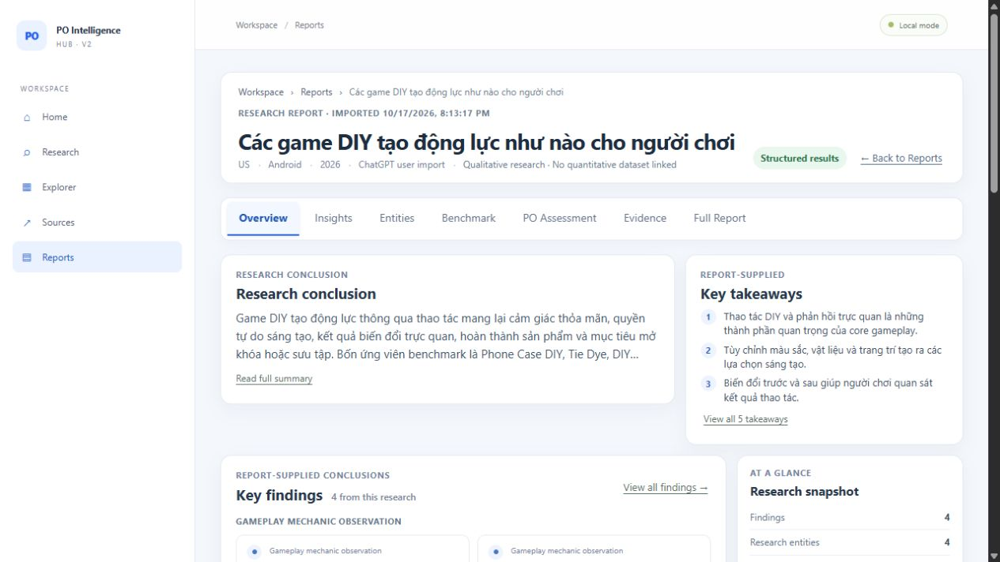
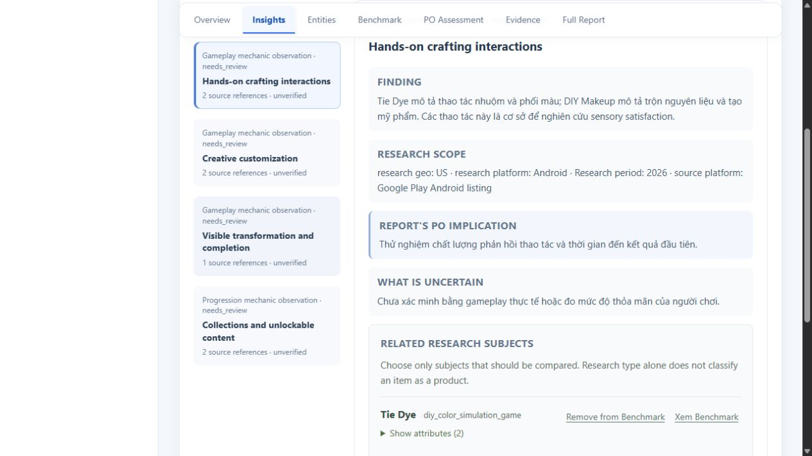
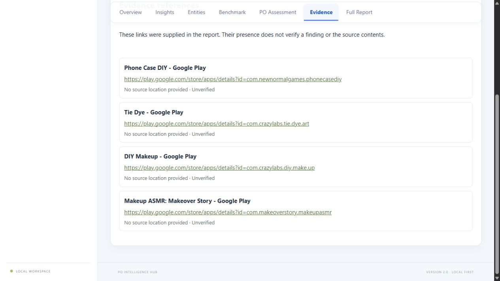
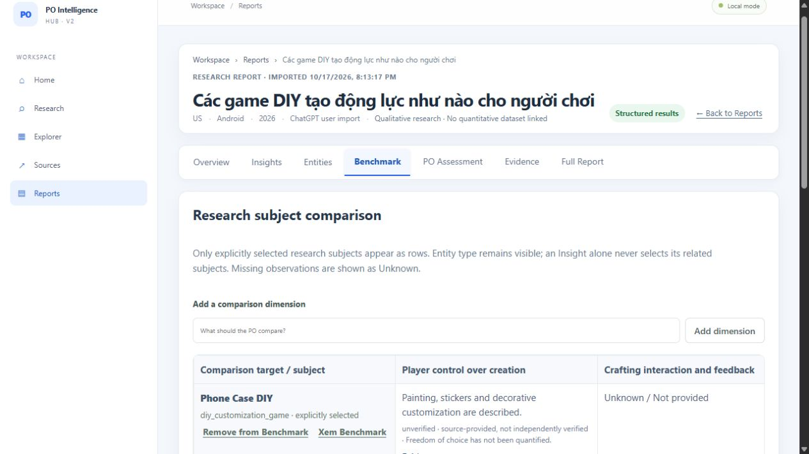
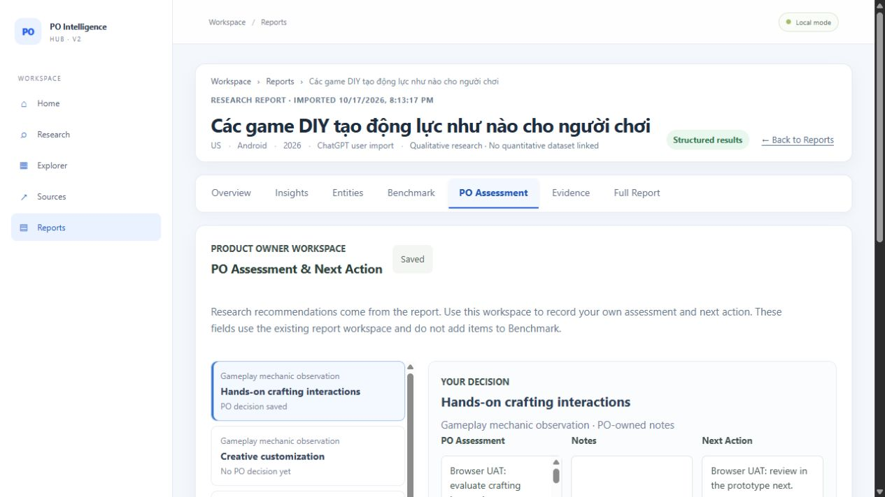
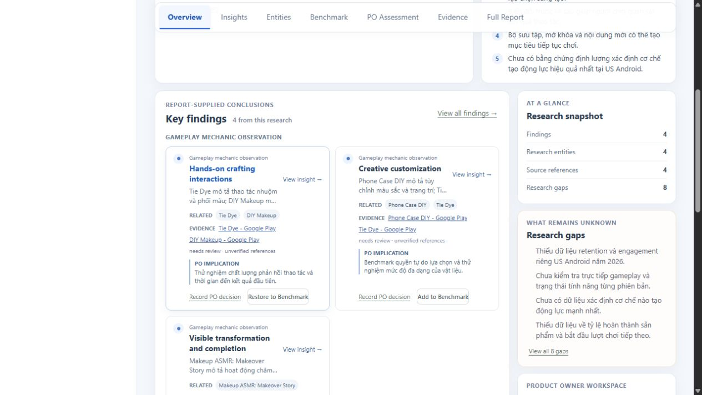

# PO HUB — UI-01: Approved Research Overview V1

## Delivery

- Branch: `feat/ux-recovery-01-research-results`
- Previous HEAD: `f760bfb08a822fea90d468d791f09b4b20509aa4`
- Implementation commit: `7d400a5e0eb2059a431f9d8cc1ea4914f2104c64`
- Status: **Awaiting Product Owner visual review**. The requested exact viewport screenshots could not all be captured in the available Codex browser, so this handoff does not claim full visual acceptance.
- Scope: V1 qualitative overview only. No CSV integration, Market Analytics, backend/schema changes, migrations, or production SQLite edits.

## V1 layout delivered

- Compact breadcrumb/report header with title, scope, provenance, status, import time, and Reports navigation. No synthetic subtitle is derived from the research question.
- Report-supplied conclusion and takeaways sit side by side on desktop. The conclusion has a short preview; takeaways show three items initially with a separate expand control.
- Key Findings use a responsive two-column card grid. Cards show supplied type, description preview, explicitly linked entities, evidence references and verification status, PO implication, and actions for Insight and PO Assessment.
- Counts are secondary in a compact Research Snapshot. Research gaps have a four-item preview and expand control. PO recommendations remain labelled as report-supplied and separate from saved PO decisions.
- Research Map displays finding-to-entity and finding-to-PO-implication links only where those relationships are explicitly present in the structured report. Unlinked fields are labelled as not supplied.
- The qualitative/no-quantitative-dataset state is a small header note; no empty chart or placeholder dashboard is rendered.
- Existing Insight, Evidence, Benchmark, PO Assessment, and Full Report interactions remain available. Benchmark membership and PO fields continue using the existing API and data structures.

## Before / after against approved V1

- **Before:** Findings were a long, text-heavy group after the summary and source/gap sections. Metadata and explanatory copy competed with the actual conclusions.
- **After:** Conclusion and key takeaways form a compact top row; findings become the primary grid with evidence and PO implication visible on each card. Snapshot, gaps, and next-step navigation live in a secondary rail. Full report remains available in its own tab.
- At the available 1280×720 browser viewport, the initial screen reaches the Key Findings cards. The exact requested 1440×900 viewport was not available to verify.

## Browser screenshots

All images below were captured from the running application in the Codex in-app browser using the actual imported DIY Game report `6a73b8bf-01d6-4954-a72d-f165bd2c1d9e`. The available viewport was 1280×720 CSS pixels.

## Browser UAT

- Opened the actual imported DIY Game report from Reports history.
- Overview showed report-supplied summary, takeaways, findings, snapshot, gaps, and PO next steps. No fabricated metrics or chart appeared.
- Opened the first Insight and reviewed its supplied finding, scope, PO implication, uncertainty, and evidence references. Opened its original-report support control; where no reliable line location was supplied, the UI stated that it would not invent one.
- Opened Evidence and confirmed four supplied references appeared as unverified.
- Opened Benchmark and confirmed two selected subjects (`Phone Case DIY`, `Tie Dye`), supplied dimensions, and two `Unknown / Not provided` observations.
- Edited an existing PO Assessment, saved, navigated to Reports, reopened the same report, and confirmed the value persisted. Restored the original PO Assessment in the isolated UAT database and reopened it to verify the original value was saved again.
- Measured the available browser at 1280×720. Document and body widths were 1265px, with no horizontal overflow; Benchmark retains its own horizontal scrolling where needed.
- **NOT VERIFIED:** exact 1440×900, 768px, and 390px browser viewports. The browser integration exposes viewport screenshots and page interactions but no viewport resize control. A full-page capture is also unavailable from this browser surface; screenshot 07 shows a separate scrolled view, not a stitched full-page image.

UAT writes used `data/.uat-ux-recovery-01/po_intelligence_hub.sqlite3`. The primary `data/po_intelligence_hub.sqlite3` was not used for UAT writes. The temporary PO edit was restored to its original value in the UAT copy.

## Tests

- Frontend tests: **36 passed, 0 failed** across 3 files.
- TypeScript check and Vite production build: **passed** (`npm run build`).
- Backend regression suite: **63 passed, 0 failed**.
- Alembic upgrade to head on a temporary SQLite database: **passed**. No migration was added.
- `git diff --check`: **passed**.
- Browser UAT: interactions listed above passed at 1280×720; requested other viewports remain NOT VERIFIED.

## Changed files

- `frontend/src/reports/ReportResults.tsx`
- `frontend/src/reports/ResearchIntake.test.tsx`
- `frontend/src/style.css`
- `.bangiao/screenshots/ui-01/01-overview-live-1280x720.png`
- `.bangiao/screenshots/ui-01/02-insight-detail-live-1280x720.png`
- `.bangiao/screenshots/ui-01/03-evidence-live-1280x720.png`
- `.bangiao/screenshots/ui-01/04-benchmark-live-1280x720.png`
- `.bangiao/screenshots/ui-01/06-po-assessment-after-reopen-live-1280x720.png`
- `.bangiao/screenshots/ui-01/07-overview-findings-live-1280x720.png`
- `.bangiao/UI-01-IMPLEMENTATION.md`

Pre-existing user changes in `scripts/setup.ps1` and `.devcrew/` were preserved and excluded.

## Limitations and review

- Exact desktop/tablet/mobile viewports and a full-page screenshot remain unverified due to the available browser's fixed viewport and viewport-only screenshot API.
- The report contract does not include a separate report description field, so the header does not display one.
- Data provenance and evidence verification remain unchanged; source URLs and structured claims are still report-supplied and unverified.
- Product Owner visual review: **Awaiting review**. No GO decision is claimed.
