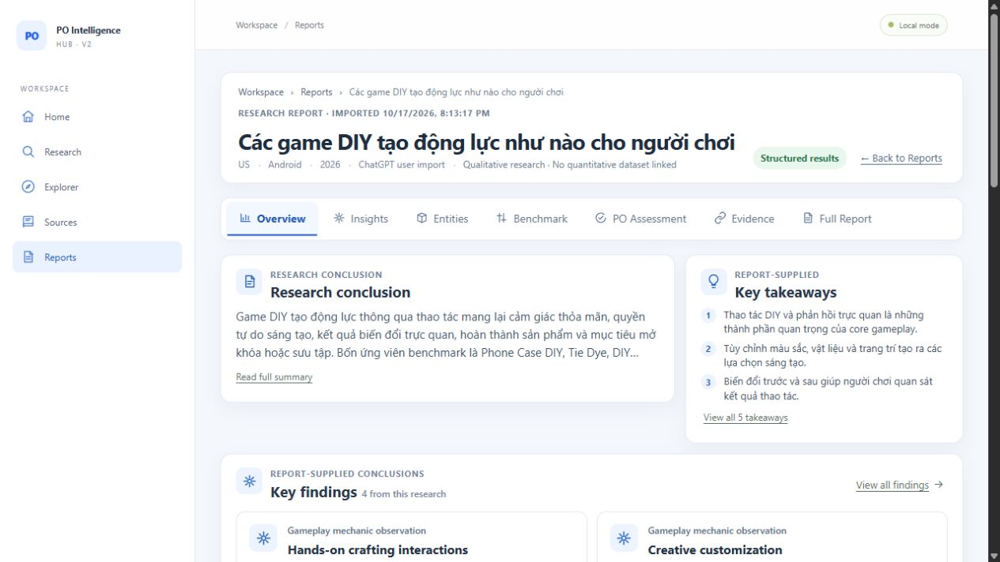
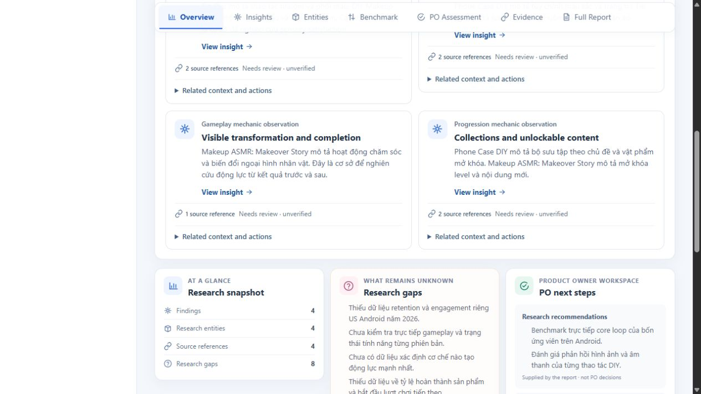
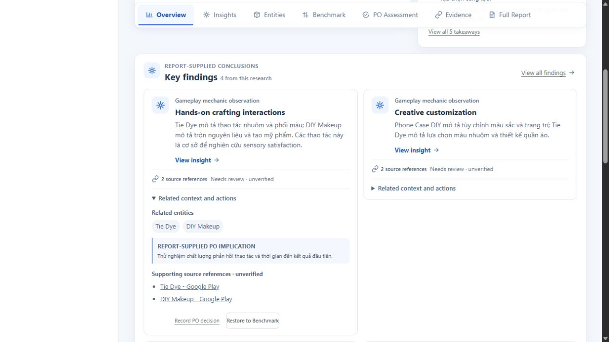
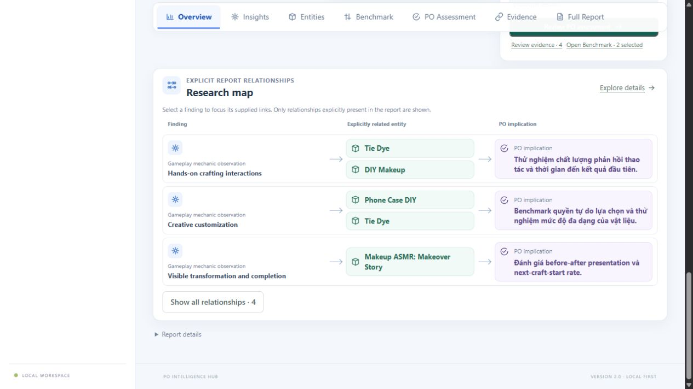
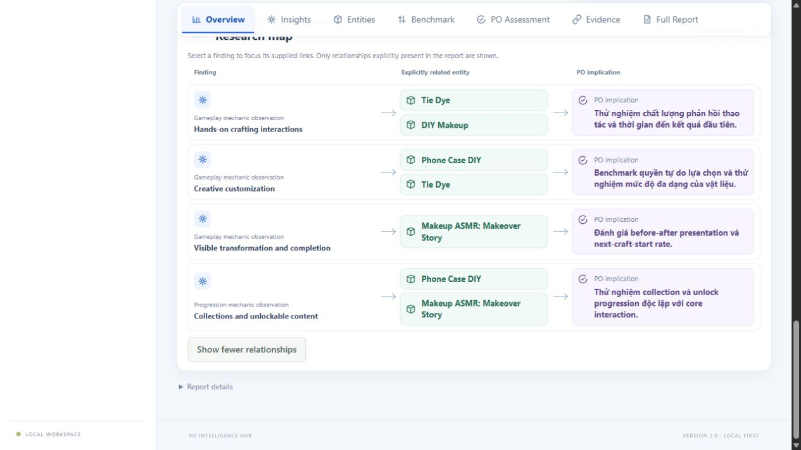
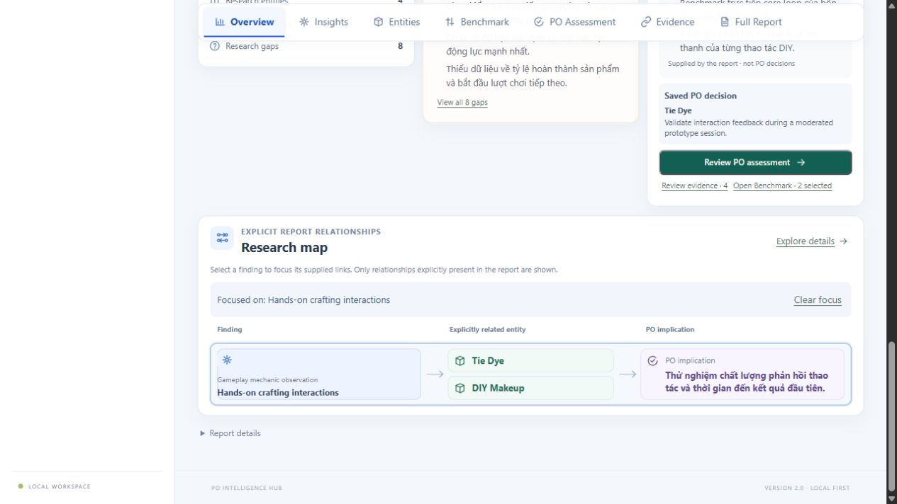
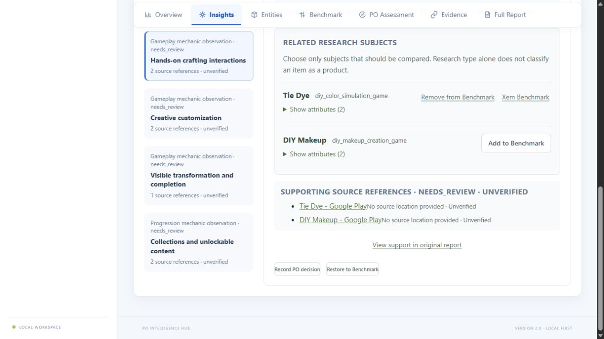

# UI-01 Visual Refinement Round 2

**Status:** Awaiting Product Owner review  
**Branch:** `feat/ux-recovery-01-research-results`  
**Original HEAD:** `8e10a21608d18e17fe6578fb8e82a9c4c76b057d`  
**Implementation commit:** `8f0136b` (`Refine research results cards and map UX`)

## Changes

- Replaced type-by-type finding subgrids with a single responsive findings grid. Each card keeps its report-supplied type and semantic icon; findings no longer leave half-empty rows when a type has an odd number of cards.
- Added container-based layout rules. The secondary rail moves below Findings when the report content area is 1020px or narrower. Finding cards use one column at 680px or narrower and two columns above that threshold.
- Kept the first-level card focused on title, description, evidence count/status, and “View insight”. Related entities, report-supplied PO implication, source links, PO assessment, and Benchmark action remain reachable in a keyboard-operable disclosure.
- Kept report source verification status explicit; references remain labelled unverified.
- Made the Research Map show three relationships by default, with “Show all relationships”, focus/clear-focus behavior, a selected state, and compact rows. Only explicit finding-to-entity and supplied PO implication links are rendered; duplicate entity keys are removed per finding.
- Added a stacked mobile map layout and visible entity label. This CSS is implemented but mobile browser rendering was not verified in this environment.

## Before / after

The [previous Overview screenshot](../ui-01-visual-fidelity/overview-first-viewport.png) shows the Findings panel squeezed beside its secondary rail, with the finding cards further split into two columns and all secondary actions competing for attention. In the current browser screenshot, the rail moves below the dominant Findings region, cards use the available width, and secondary information opens on demand.

The previous [Research Map screenshot](../ui-01-visual-fidelity/research-map.png) shows all relationships as a long repeated list. The updated default shows a short set of compact rows and exposes the remainder through an explicit control; a selected finding can be isolated without leaving the map.

## Browser UAT

Used the real imported qualitative report “Các game DIY tạo động lực như nào cho người chơi” from the isolated UAT SQLite copy (`data/.uat-ux-recovery-01`), report ID `6a73b8bf-01d6-4954-a72d-f165bd2c1d9e`. No production SQLite file was used and no report/PO/Benchmark mutation was issued.

- Confirmed Overview, finding cards, card disclosure, supplied source links, PO decision action, Benchmark action, Evidence tab, and Insight tab are present and navigable.
- Confirmed the default map displays 3 of 4 relationships; “Show all relationships” displays all 4; selecting a finding focuses it and “Clear focus” restores the list.
- Confirmed existing saved PO decision and two Benchmark selections remained visible during the read-only session.
- Browser measured `innerWidth=1280`, `innerHeight=720`; report content width 951px, finding card columns 449.5px each, and `documentElement.scrollWidth=1265` (no horizontal document overflow at the measured viewport).
- 1440×900, 1076×828, 768px, and 390px were **NOT VERIFIED**: the available Codex browser does not expose viewport resizing. The only visual UAT viewport is the measured 1280×720 session.
- No save/refresh/reopen write cycle was performed; this visual task did not modify persistence code and the real report was inspected read-only.

### Screenshots

All images below are captures from the running local application, not mockups.

**Overview first viewport**

**Findings default state**

**Finding card expanded**

**Research Map default and expanded**

**Research Map focused on a finding**

**Insight / Evidence navigation check**

## Tests

- Frontend tests: **37 passed** (`3` files).
- TypeScript check: **passed**.
- Production frontend build: **passed**.
- `git diff --check`: **passed**.
- Backend tests: not run; no backend, schema, or API files changed.

Targeted test coverage now verifies that secondary PO and Benchmark actions remain available after expansion, supporting source links remain accessible, sparse findings render explicit “No entity link supplied” / “No PO implication supplied” states without connectors, and map expand/collapse/focus only reveals explicit relationships.

## Files changed

- `frontend/src/reports/ReportResults.tsx`
- `frontend/src/reports/ResearchIntake.test.tsx`
- `frontend/src/style.css`
- `.bangiao/screenshots/ui-01-refinement-r2/` (7 actual-browser screenshots)

No backend, database, migration, production SQLite, or unrelated workspace files were changed by this task. Existing user changes in `scripts/setup.ps1` and `.devcrew/` were left out of the commit.

## Remaining limitations and review

- Exact target viewport verification is unavailable as stated above; the responsive behavior should be reviewed on the owner’s desktop/tablet/mobile sizes.
- No persistence write was performed during UAT, so saved-data preservation is supported by unchanged persistence code and observed existing saved state, not a new save/refresh cycle.
- Recommendation: **Awaiting Product Owner visual review**. No merge was performed.
