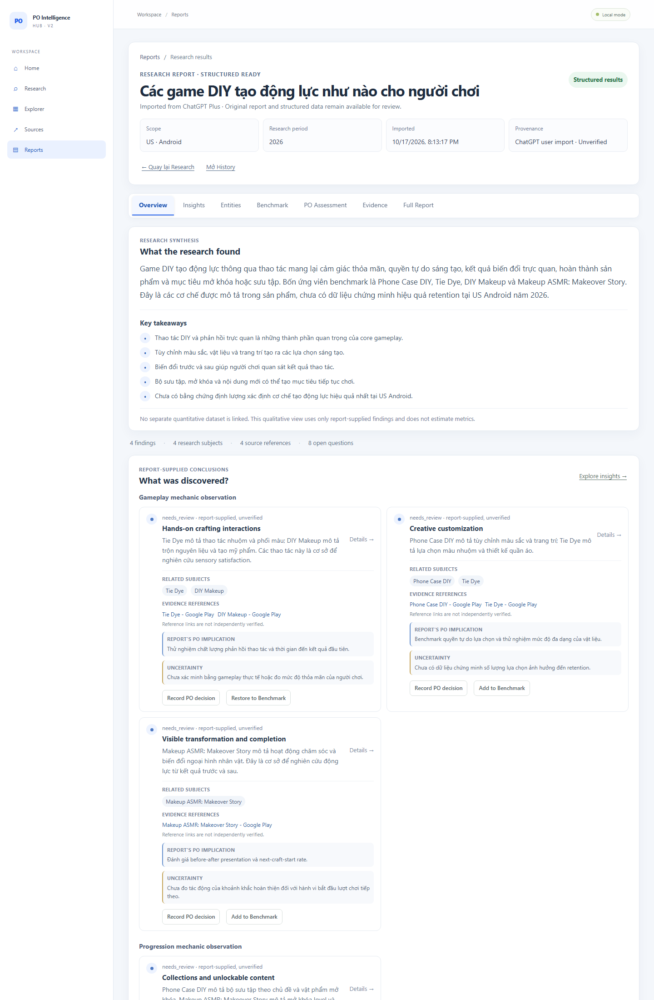
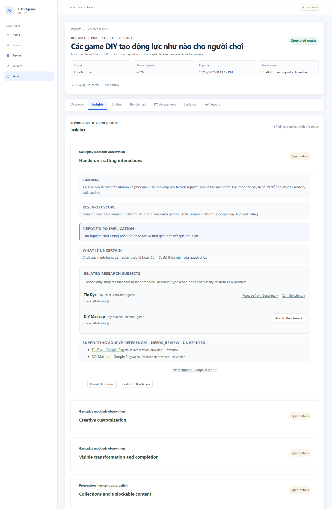
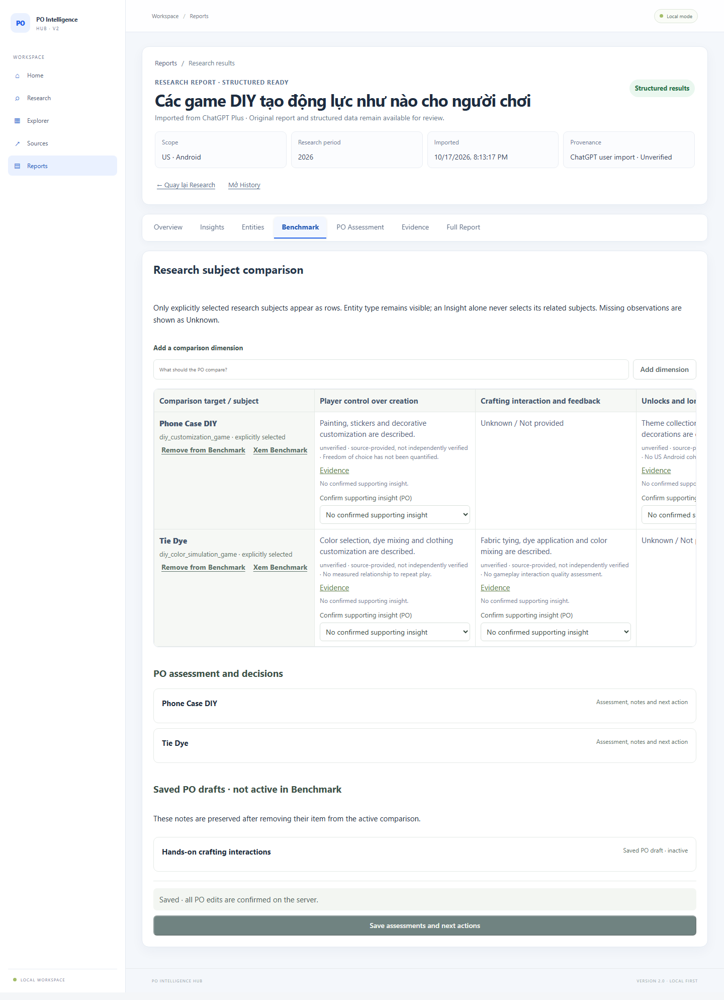
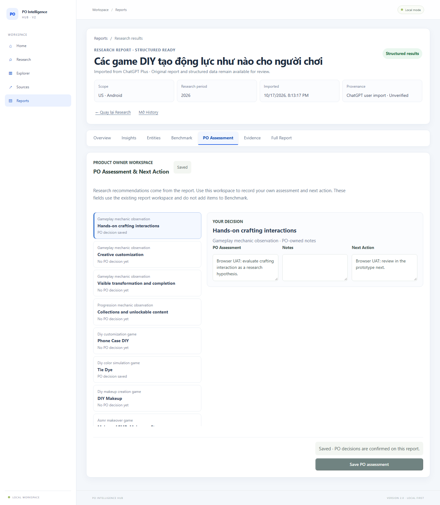
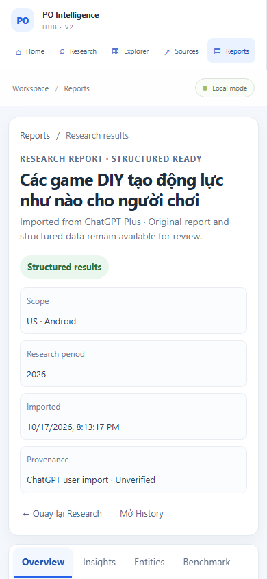

# UX-RECOVERY-01 — Review Phase 2 Handoff

## Scope and result

Implemented the bounded UI corrections after Product Review returned NEED FIX. This commit is based on `feat/ux-recovery-01-research-results` at `ed4679b62fb5f45aac3df858bd7b2da11c19ebd4` and does not merge to master.

Overview now leads with the report's supplied research summary and findings. Finding groups use the report-supplied `finding_type`; cards show only supplied entity links, source references, PO implications, and uncertainty. Research gaps are presented separately because `po_research_v1` does not provide a finding-to-gap relationship. Counts are secondary metadata and the no-quantitative-data state is a compact note.

Insights use the same visual hierarchy and progressive disclosure. A separate PO Assessment tab offers a direct path from findings and subjects to editable PO Assessment, Notes, and Next Action using the existing benchmark workspace endpoint. This path does not add those items to Benchmark. Existing Benchmark membership, values, legacy dimensions, and user notes remain supported; missing observations remain Unknown.

No backend, API contract, schema, migration, production SQLite file, or Research Run Manifest was changed.

## Files changed

- `frontend/src/reports/ReportResults.tsx`
- `frontend/src/reports/ResearchIntake.test.tsx`
- `frontend/src/style.css`
- `.bangiao/UX-RECOVERY-01-phase2-overview.png`
- `.bangiao/UX-RECOVERY-01-phase2-insight-detail.png`
- `.bangiao/UX-RECOVERY-01-phase2-benchmark.png`
- `.bangiao/UX-RECOVERY-01-phase2-po-assessment.png`
- `.bangiao/UX-RECOVERY-01-phase2-mobile-390.png`
- `.bangiao/UX-RECOVERY-01-phase2-viewport-check.json`

Pre-existing `scripts/setup.ps1` and `.devcrew/` changes were preserved and excluded.

## Browser UAT

**Verified in a real browser** using the actual imported qualitative report “Các game DIY tạo động lực như nào cho người chơi” in the isolated local UAT SQLite copy. Production SQLite was not used.

- Overview showed the report summary, report-supplied findings, related entities, source links, PO implications and uncertainties. Source links remained labeled unverified; no finding-to-gap links or quantitative values were invented.
- Opened an Insight and followed **Record PO decision** to the dedicated PO Assessment tab without adding the finding to Benchmark.
- Entered PO Assessment and Next Action, saved through the existing `PUT /api/v1/reports/{report_id}/benchmark-state` endpoint, refreshed, reopened, and confirmed both values remained.
- Added Phone Case DIY to the Benchmark, removed it, restored it, refreshed, and confirmed membership persisted. Existing Tie Dye PO notes remained visible.
- Screenshots were captured from Chrome at 1440px for Overview, Insight Detail, Benchmark, and PO Assessment; an additional 390px Overview screenshot is included.

### Screenshots

**Overview**

**Insight detail**

**Benchmark matrix**

**PO Assessment and Next Action**

**390px mobile Overview**

## Responsive checks

Measured browser viewport widths: **1440, 1024, 768, and 390 CSS pixels**. At each width, `documentElement.scrollWidth` and `body.scrollWidth` did not exceed `window.innerWidth`. No page-level horizontal overflow was detected. The Benchmark matrix keeps its own horizontal scroll area for wide comparison dimensions.

Detailed measurements: `UX-RECOVERY-01-phase2-viewport-check.json`.

## Tests

- Frontend tests: **36 passed, 0 failed** (3 test files).
- TypeScript check and Vite production build: **passed** (`npm run build`).
- Backend regression tests: **63 passed, 0 failed** (`python -m unittest discover -s tests -v`).
- Alembic schema check in backend regression run: **passed**, no new upgrade operations.
- `git diff --check`: **passed**.

## Limitations

- This report has no linked quantitative dataset; the dashboard intentionally shows qualitative results without charts or estimated metrics.
- The supplied source URLs and structured research remain unverified. The source locations for this report were not supplied, so the UI does not claim exact report locations.
- The research contract does not explicitly link gaps to findings; the UI keeps gaps at report level.
- Product owner review of this Phase 2 implementation is pending.

## Commit

- Branch: `feat/ux-recovery-01-research-results`
- Implementation commit SHA: `de03d807567b56305fbfb1b27fd4d98e70dfd441`
- Push/merge: this branch is being pushed for owner review; master is unchanged.

